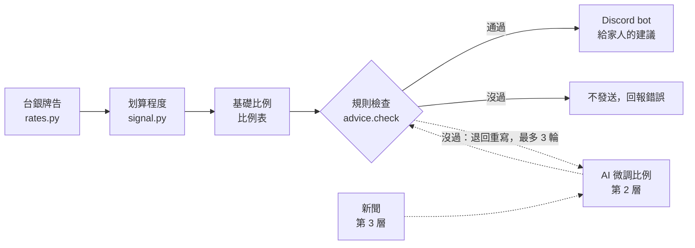

# 換匯時機顧問 Agent（人民幣・日幣・台幣）

在 Discord 上告訴家人：**人民幣現在換台幣划不划算、這次該換幾成；日幣夠不夠便宜、要不要買。**

只給建議，不自動交易。資料來源是台灣銀行牌告匯率。

> 生成式 AI 課程期末專案｜中央大學 化材系 李宸緯

## 現在能做什麼（第 1 層）

| 指令 | 回答 |
|---|---|
| `/匯率` | 人民幣、日幣現在的牌告，近一年範圍，以及「划算程度」 |
| `/建議` | 這次人民幣換幾成、日幣買不買（附規則檢查） |
| `/走勢` | 畫出最近 30～730 天的走勢圖 |
| `/回測` | 過去兩年不同換匯做法的比較 |
| `/說明` | 指令列表 |

設定了頻道的話，每週二、週五早上 10 點會自動發一次建議。

**划算程度**＝近一年（前 250 個營業日）有幾 % 的日子比現在差。
例如人民幣 90 分，就是「現在換台幣，比近一年 90% 的日子都划算」。

## 流程



虛線是之後的第 2、3 層：AI 讀新聞後在基礎比例上微調，但一樣要過規則檢查；AI 失敗就退回純規則的基礎比例。

## 回測結果

2024-12 ～ 2026-11，每月入帳 1 萬人民幣、撥 1 萬台幣買日幣（假設的單位，不是真實金額）。

| 做法 | 人民幣：1 元平均換到 | 日幣：1 萬平均花費 |
|---|---|---|
| A 收到就換 | 4.4704 | 2,074.5 |
| B 每週分批（對照） | 4.4797 | 2,071.3 |
| C 只看位置 | **4.4959** | **2,052.6** |
| E 延後分批（不看匯率，持有天數跟 C 一樣） | 4.4894 | 2,071.4 |

- 人民幣：C 比 B 每 1 萬人民幣多換 162 台幣，但其中 96 台幣只是因為「晚點換」碰上人民幣升值（E 也拿得到），真正來自看位置的約 66 台幣
- 日幣：C 每 1 萬日幣比 B 省 18.7 台幣，E 跟 B 幾乎一樣，所以差距來自看位置；但有 13% 的預算一直等不到便宜時機
- 完整報告與交易點圖：[reports/backtest.md](reports/backtest.md)

## 在自己電腦上跑

需要 Python 3.10 以上。

```bash
pip3 install -r requirements.txt
python3 -m unittest discover tests      # 13 項測試
python3 scripts/update_rates.py         # 從台銀補最新匯率
python3 scripts/advise.py               # 不用 Discord，直接看這次建議
python3 scripts/run_backtest.py         # 重跑回測，更新 reports/
python3 bot.py                          # 啟動 Discord bot
```

bot 的 token 放在**家目錄**的 `fxbot.env`（格式見 `fxbot.env.example`），不要放在專案資料夾，避免跟著專案上傳。

## 結構

```
fxagent/   核心程式（設定、匯率、划算程度、建議與規則檢查、回測、畫圖、bot 回覆文字）
bot.py     Discord bot
scripts/   更新匯率、看建議、跑回測
tests/     單元測試（含「不偷看未來」與「錢的總數守恆」）
data/      台銀牌告 2023-12 起
reports/   回測報告
CLAUDE.md  給 AI 的工作規則
```

## 接下來

- **第 2 層**：AI（本機 Claude Code 無頭模式）讀新聞，判斷短期偏升或偏貶，在基礎比例上微調；規則沒過就退回重寫；加入回測 D
- **第 3 層**：新聞自動抓取（先關鍵字篩、再逐則判斷）；在 Discord 直接打字問問題，回答附新聞出處

## 免責

這是決策輔助工具，不是投資建議。匯率短期很難預測，回測結果只代表過去這段行情。
