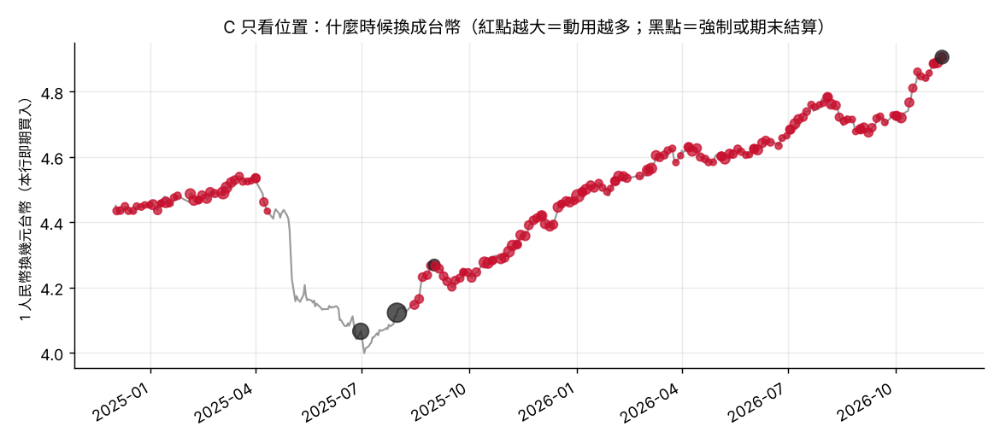
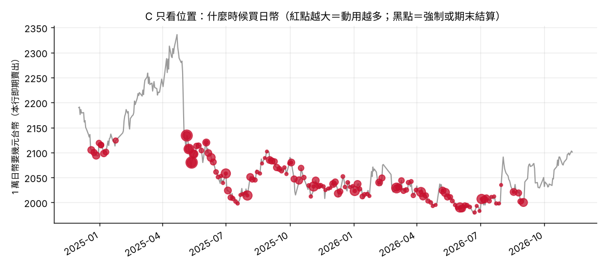

# 回測結果（第 1 層）

- 期間：2024-12-01 ～ 2026-11-10（台銀牌告，每日收盤）
- 假設：每月第一個營業日入帳 10,000 人民幣；每月撥 10,000 台幣當買日幣預算
- 判斷日：每週二、週五；划算程度用「前一個營業日以前」的近 250 個營業日計算（不偷看未來）
- 人民幣放滿 90 天一定要換；期末還沒換的以最後一天牌告結算
- 由 `python3 scripts/run_backtest.py` 產生，數字不要手改

## 人民幣

| 做法 | 1 人民幣平均換到（台幣） | 跟 B 比 | 平均持有天數 | 交易次數 | 備註 |
|---|---|---|---|---|---|
| A 收到就換 | 4.4704 | -93 台幣／每 1 萬人民幣 | 0.0 | 24 |  |
| B 每週分批 | 4.4797 | — | 13.4 | 188 |  |
| C 只看位置 | 4.4959 | +162 台幣／每 1 萬人民幣 | 32.3 | 178 | 強制換 20,075；期末結算 4,688 |
| E 延後分批（對照） | 4.4894 | +96 台幣／每 1 萬人民幣 | 30.1 | 398 | 不看匯率，平均分到入帳後 65 天內 |

## 日幣

| 做法 | 1 萬日幣平均花費（台幣） | 跟 B 比 | 平均持有天數 | 交易次數 | 備註 |
|---|---|---|---|---|---|
| A 收到就換 | 2,074.5 | +3.2 台幣／每 1 萬日幣 | 0.0 | 24 |  |
| B 每週分批 | 2,071.3 | — | 13.4 | 188 |  |
| C 只看位置 | 2,052.6 | -18.7 台幣／每 1 萬日幣 | 20.7 | 147 | 預算剩 30,678 台幣沒用（用掉 87%） |
| E 延後分批（對照） | 2,071.4 | +0.1 台幣／每 1 萬日幣 | 19.0 | 257 | 不看匯率，平均分到入帳後 41 天內 |

## 怎麼讀

- 人民幣：C 比 B 每 1 萬人民幣多換到 +162 台幣；但 E（只是晚一點換、不看匯率）也多了 +96。
  所以 C 的優勢裡，真正來自「看位置」的只有 C − E ≈ +66 台幣，其他是因為這段期間人民幣整體是升值的，晚一點換本來就比較划算。
- 日幣：C 每 1 萬日幣比 B 省 18.7 台幣，E 跟 B 幾乎一樣（+0.1），代表日幣這邊的差距主要來自「看位置」，不是延後。
  但 C 有 30,678 台幣預算一直等不到便宜的時候，沒有花掉。
- 兩年的資料只是一段行情，結果會隨期間改變；這也是第 2 層要加入新聞、第 3 層要實際執行累積紀錄的原因。
